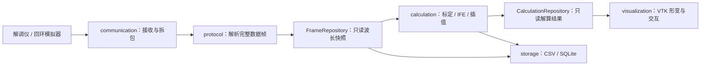

# FOSD 光纤传感解调仪上位机

FOSD（Fiber Optic Sensing Demodulator）用于接收光纤解调仪的波长数据，完成应变标定、IFE 解算与模型逐点插值，并提供三维形变显示及数据存储。

当前重构版本为 **V3.0.0**，主要应用入口是 **FOSD-Classic-QWidgets**。项目采用 C++11、Qt 5.12.2、VTK 8.2 和 CMake，当前构建预设面向 Windows x64 / MSVC 2017。

许可证：[GNU GPL v3 或更新版本（GPL-3.0-or-later）](LICENSE)。

源码与真实工程数据分开管理：仓库中的 `data` 仅保留 QSS 样式与许可证，模型、点阵、标定和采集数据由使用者在本地提供。详细边界见 [私有数据说明](doc/Architectural/private-data-boundary.md)。

## 功能与应用入口

| 能力 | 当前实现 |
| --- | --- |
| 通信 | 串口指令收发、UDP 数据报、TCP 流式拆包；连接状态与错误上报 |
| 协议解析 | MP / JCS 波长协议，结构化只读数据帧，支持扩展拆包规则与解析器 |
| 标定与解算 | 参考波长标定、通道重排、比例与偏置；默认 HYY IFE 算法及模型逐点插值 |
| 三维显示 | STL 模型导入、变形倍率、位移标量着色、相机与场景、选点及持续显示标记 |
| 数据存储 | CSV / SQLite；原始波长、标定后的硬件数据、指定点位移 |
| 参数配置 | 分区 INI、统一读写接口、参数校验、默认模板与运行配置分离 |
| Classic 界面 | Designer `.ui` 表单、三层 MVP、深浅主题、通信日志、波长曲线与数据表 |
| 验证工具 | UDP 回环模拟器、模块测试、通信至存储的全链路测试及工作台集成测试 |

| 应用 | configure 预设 | 说明 |
| --- | --- | --- |
| `FOSD-Classic-QWidgets` | `fosd-widgets` | 完整业务主界面，开发和联调优先使用此入口 |
| `FOSD` | `windows-msvc2017` | 保留的 FOSD-Win 入口，未装配完整 Classic 业务链路 |
| `communication-assistant-QML` | `communication-assistant-QML` | 独立 QML 通信助手 |
| `CommunicationAssistantWidgets` | `communication-assistant-widgets` | 独立 QWidgets 通信助手 |

算法通过 `IFrameIFE` 接口接入，解算层将其作为黑箱调用。软件测试验证输入输出、数据传输和运行流程；模型适用范围、标定有效性及物理精度需要结合实际设备和模型另行验证。

## 架构与数据流

Classic 前端采用 **View → Presenter → WorkbenchModel**：View 负责表单展示，Presenter 负责交互和展示状态，Model 编排 `src` 中的业务 Control。通信、协议、解算、存储与可视化保持为可复用的独立模块。



`ProtocolControl` 管理通信/解析工作线程，集成模式下 `ConnectWorker` 与 `ProtocolWorker` 在同一线程内处理数据。解算在独立工作线程运行，存储写入由该线程托管；VTK 渲染和界面交互在 GUI 线程进行。共享仓库通过线程锁及只读快照提供跨模块访问。

三类点分别管理：**KeyPoints** 是默认包含全部模型点的集合，不创建 Actor；**SelectedPoints** 是受关键点集合约束的当前选中点；**DisplayedPoints** 是独立的持续显示集合，可包含关键点和模型外固定坐标点，初始为空。

## 环境与构建

| 依赖 | 要求 |
| --- | --- |
| 操作系统 | 当前预设面向 Windows x64，图形界面需要可用的 OpenGL 环境 |
| 编译器 | Visual Studio 2017，安装桌面 C++ 工具与 Windows SDK |
| CMake | 使用预设需要 3.20 或以上；本机已验证独立安装的 4.4.4 |
| Qt | 5.12.2 `msvc2017_64`，包含 Core、Widgets、Network、SerialPort、Sql、OpenGL、PrintSupport、Test |
| VTK | 8.2，匹配 Qt / MSVC / x64，包含 `QVTKOpenGLNativeWidget` 所需的 Qt 支持模块 |
| 可选依赖 | QML 助手需要 Qml、Quick、QuickControls2；公开数据检查脚本使用 Python 3 |

仓库中的 VTK SDK 为裁剪版本，运行 DLL 需另行准备。当前 CMake 同时查找 Debug / Release 库；头文件、链接库和运行 DLL 必须匹配，Debug 程序需使用对应 Debug 运行库。

在仓库根目录配置 **Classic 完整版本**。下面的 Qt / VTK 路径是示例，请替换为自己的安装位置；VTK 目录需包含 `include/vtk-8.2`、`lib` 和运行库目录。

```powershell
git clone https://github.com/Swimers/FOSD_Project.git
cd FOSD_Project

$qtRoot = 'C:/Qt/5.12.2/msvc2017_64'
$vtkRoot = 'C:/Deps/VTK-8.2'
$env:PreferredToolArchitecture = 'x64'

cmake --preset fosd-widgets `
    -DFOSD_QT_ROOT="$qtRoot" `
    -DFOSD_VTK_TYPES_INCLUDE_DIR="$vtkRoot/include/vtk-8.2" `
    -DFOSD_VISUALIZATION_VTK_ROOT="$vtkRoot" `
    -DFOSD_VISUALIZATION_VTK_RUNTIME_DIR="$vtkRoot/bin"

cmake --build --preset fosd-widgets-release

$env:PATH = "$qtRoot/bin;$vtkRoot/bin;$env:PATH"
ctest --preset fosd-widgets-release
& ./build/fosd-widgets/bin/Release/FOSD-Classic-QWidgets.exe
```

私有仓库的克隆需要相应访问权限。预设中的默认 Qt 路径来自开发环境，首次配置时应覆盖；测试预设也包含该默认路径，在其他机器上需像上例一样补充实际 Qt 运行库路径。

Debug 使用 `fosd-widgets-debug` 构建和测试预设，可执行文件位于 `build/fosd-widgets/bin/Debug/`。应先完成构建再运行测试，避免 DLL 部署时文件被占用；完整图形测试需要可用桌面和 OpenGL 上下文。

若安装了嵌入式 SDK，先用 `cmake --version`、`where.exe cmake` 确认实际使用的 CMake。VS Code 可在工作区设置 `cmake.cmakePath` 指向独立安装版本，并选择 `fosd-widgets` 配置预设。各应用使用独立缓存；不要复用其他工具链生成的构建目录。更多预设及开关见 [构建说明](doc/build-presets.md)。

## 无设备验证与基本流程

无需真实设备即可运行波长协议回环自检：

```powershell
cmake --build --preset fosd-widgets-release --target MPWavelengthSimulator
& ./build/fosd-widgets/bin/Release/MPWavelengthSimulator.exe --self-test
```

模拟器仅向 `127.0.0.1` 发包。与主界面联调时，在通信页选择 UDP、本地地址 `127.0.0.1`、本地端口 `9000`；目标地址填 `127.0.0.1`、目标端口填 `9001`，打开网络后执行：

```powershell
& ./build/fosd-widgets/bin/Release/MPWavelengthSimulator.exe --port 9000 --count 100 --interval 20
```

先在波长表和日志中确认收包与解析，再按设备数据配置参考波长、标定系数和通道映射，导入本地 STL 模型，启用解算与三维显示，并按需开启存储。模拟器不会自动完成标定或导入模型；详细参数及自检范围见 [模拟器说明](tools/mp-wavelength-simulator/README.md)。

## 配置与本地数据

核心参数定义于 `src/config/CoreParameters.h`。`src/config/core-defaults.ini` 是源码默认模板，构建后复制到可执行文件目录的 `config/core-defaults.ini`；运行时修改写入 `config/parameters.ini`，不覆盖默认模板。`FOSD_CONFIG_FILE` 环境变量可指定独立运行配置，便于测试或多实例使用。

通道标定按输出通道顺序计算：

```text
输出应变[j] = 标定应变[channelIndices[j]] × calibrationFactors[j] + calibrationOffsets[j]
```

偏置数组默认为空，等价于全部为零；显式提供时须与映射等长，且全部为有限数值。设备连接、标定与存储仍需显式启用。接口、校验和配置恢复行为见 [核心参数](doc/Architectural/core-parameters.md) 与 [解算说明](doc/Architectural/calculation-integration.md)。

真实模型、点阵、标定与采集数据不随源码分发。`data` 下除 `QSS` 外的内容，以及历史构建副本和 FOSD 主程序 ZIP，均由忽略规则隔离。缺少工程模型不会阻止源码构建，运行时请自行导入有权使用的数据。提交前检查：

```powershell
python tools/check-public-data.py
python tools/check-public-data.py --history
git ls-files data
```

最后一项应只列出 QSS 资源。忽略规则和路径扫描不能替代保密审查，禁止将真实数据强制加入 Git；重新发布二进制前也应检查其资源与配置内容。历史数据已清理并重写提交 ID，协作者应重新克隆，避免将旧历史合并或推送回来。完整范围及服务器缓存处理事项见 [公开源码与私有数据边界](doc/Architectural/private-data-boundary.md)。

## 目录与开发文档

```text
FOSD_Project/
├── apps/                     # 应用启动入口与可执行文件目标
├── ui/
│   ├── FOSD-Classic-QWidgets/ # application / model / features / common / controls / resources
│   ├── communication-assistant-QML/
│   └── CommunicationAssistantWidgets/
├── src/
│   ├── communication/        # 传输控制、工作器、拆包规则
│   ├── protocol/             # 协议解析器与帧发布
│   ├── core/Datamodel/       # 只读帧、模型、标定与解算结果仓库
│   ├── config/               # 分区 INI、参数定义与校验
│   ├── calculation/          # 波长标定、IFE 与插值计算
│   ├── storage/              # CSV / SQLite 写入
│   ├── visualization/        # 网格、形变、标量、标记、交互和场景
│   └── logging/              # 预留模块
├── test/                     # 后端模块与全链路测试
├── tools/                    # 回环模拟器、代码格式化及数据边界检查
├── data/QSS/                 # 受 Git 跟踪的样式资源与许可证
├── lib/                      # 第三方依赖 SDK
├── doc/                      # 架构、协议、迁移与验证说明
├── cmake/                    # 平台构建设置
├── Release/                  # 发行说明与保留的模拟器文件
├── build/                    # 本地构建输出，不进入 Git
├── CMakeLists.txt
├── CMakePresets.json
└── LICENSE                   # GNU GPLv3 正文，项目采用 v3 或更新版本
```

| 文档 | 内容 |
| --- | --- |
| [开发文档入口](doc/README.md) | 各模块与历史记录索引 |
| [Classic 界面](ui/FOSD-Classic-QWidgets/README.md) | 当前目录、MVP 分工和装配 |
| [三层 MVP 连接指南](doc/Architectural/classic-mvp-ui-backend-connection.md) | View / Presenter / Model 的接口与状态传递 |
| [协议与共享数据](doc/Architectural/protocol-integration.md) | 通信、解析及只读数据交换 |
| [存储对接](doc/Architectural/storage-integration.md) | 线程托管、数据类型及写入扩展 |
| [关键点与拾取](doc/Architectural/keypoint-picking-integration.md) | 三类点集合、标记与交互 |
| [场景与相机](doc/Architectural/scene-environment-integration.md) | 网格、坐标轴、背景和相机 |

## 参与开发

修改前请先阅读对应模块说明，保持界面、业务编排与底层 Control 的职责边界。新增协议、存储方法或算法时通过现有接口扩展，并补充覆盖实际行为的测试；提交说明应包含修改目的、验证方式及使用限制。代码格式遵循 `.clang-format`，可使用 `tools/format-source.ps1` 整理。

提交前检查差异与暂存内容，运行相关测试及数据边界检查。使用合成数据或经过确认可公开的样例，避免将工程数据作为测试夹具、截图附件或发行包资源上传。

## 许可证

本项目原创源码采用 **GNU General Public License v3.0 or later**，即 GNU GPL 第 3 版或你选择的任何更新版本。SPDX 标识为 **`GPL-3.0-or-later`**，许可证正文见 [LICENSE](LICENSE)。

该许可证允许使用、学习、修改、分发及商业使用。再分发受 GPL 约束的软件及其修改版本时，应遵守对应源码提供、许可与版权声明保留等要求；软件按许可证约定不提供担保，具体权利与义务以许可证正文为准。

Qt、VTK、QCustomPlot、QSS 等第三方组件和资源保留各自的版权及许可证声明，使用与分发时需同时遵守对应条款。未随仓库分发的工程模型、点阵、标定和采集数据不在本项目源码许可的授权范围内，详见 [私有数据边界](doc/Architectural/private-data-boundary.md)。

## 致谢与联系

感谢 Qt、VTK 等项目，以及楚辉超、凌立瞳的指导和帮助。

作者：SuningJan · 邮箱：[1229419727@qq.com](mailto:1229419727@qq.com) · 项目：[Swimers/FOSD_Project](https://github.com/Swimers/FOSD_Project)
