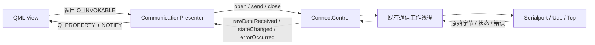

# 独立三合一通信助手

这是用于学习、调试通信模块的独立程序，提供 SerialPort、UDP 和 TCP 原始字节收发。界面使用 Qt Quick Controls 2，采用 MVP 架构。它不创建协议控制器，也不进行包头、包尾或协议字段解析。

## 目录与模块连接

```text
ui/CommunicationAssistant/
├── CommunicationPresenter.h/.cpp  # 参数校验、命令转发、状态与显示数据
├── qml/Main.qml                   # View：连接配置、收发区域、状态与计数
├── resources.qrc                  # QML 嵌入可执行程序
├── tests/PresenterTests.cpp       # 校验、UDP/TCP 实际收发与错误恢复
├── tests/QmlTests.cpp             # 界面加载、通道切换与软件渲染
└── CMakeLists.txt                 # Presenter 库及其测试
apps/CommunicationAssistant/
├── main.cpp                      # QGuiApplication、上下文对象、QML 引擎
└── CMakeLists.txt                 # 独立程序及界面测试入口
```



Presenter 在界面线程创建和销毁，通信 I/O 继续在 `ConnectControl` 管理的线程中执行。程序先销毁 QML 引擎，再销毁 Presenter；后者销毁通信对象时关闭全部通道并等待工作线程退出。

构造 `ConnectControl` 时传入具名函数 `rawOnlyDecoder`，对所有通道返回空拆包器。必须传入这个非空工厂：直接使用默认构造会启用原有拆包规则。Presenter 只订阅 `rawDataReceived`，应用不链接 `fosd_protocol` 或 `fosd_core`。原有通信源码和主程序入口无需调整。

## 操作与数据约定

- 串口支持端口扫描或手动输入端口名、自定义波特率、5–8 数据位、无/偶/奇校验、1/2 停止位及无/硬件/软件流控。
- UDP 指定本地 IP 和端口绑定；发送区域可独立修改目标 IP 和端口。地址使用 IP 字面量，端口范围为 1–65535。
- TCP 客户端支持远端 IP 或主机名；服务端使用本地绑定 IP。沿用底层单客户端限制，客户端断开后继续监听。
- 三种通道可以分别保持连接；切换类型只切换配置视图和发送目标，关闭按钮只关闭当前选中的通道。收发记录及计数汇总全部通道。
- 文本发送按 UTF-8 编码；HEX 发送接受十六进制数字与空白，必须每两位组成一个字节，拒绝 `0x` 前缀和不完整字节。追加 CRLF 在两种模式下均追加 `0D 0A`。
- HEX 显示可以切换已有记录的显示方式。文本显示保留内嵌 NUL 并显示为 `\0`，CR 显示为 `\r`；非 UTF-8 数据可能显示替换字符，二进制内容宜使用 HEX。TCP/串口的读取块不等于完整消息，跨读取块的 UTF-8 字符也可能出现替换字符。
- 接收计数记录实际接收字节数；发送计数与 `TX请求` 记录表示已提交到通信线程的请求，底层尚未提供发送完成确认，因此不能据此判断对端已收到。传输错误通过 `errorOccurred` 显示在底部及日志中。
- 显示记录最多 300 条、保留的二进制总量最多 256 KiB，每条最多显示 4096 字节；截断会明确提示。原始 `dataReceived(int channel, QByteArray bytes)` 信号及接收计数保持完整，适合扩展学习功能。清空记录与计数清零相互独立。

## 独立构建

环境：CMake ≥ 3.20、MSVC 2017 x64、Qt 5.12，Qt 组件需要 Core、Network、SerialPort、Qml、Quick、QuickControls2；测试另需 Test。运行时需要 Qt Quick Controls 2 的 QML 模块。

在仓库根目录执行：

```powershell
cmake --preset communication-assistant
cmake --build --preset assistant-debug
ctest --preset assistant-debug
```

生成 Debug 程序：`build/communication-assistant/bin/Debug/CommunicationAssistant.exe`。运行前将 Qt kit 的 `bin` 加入 PATH，或按下一节部署依赖。

```powershell
$env:PATH = 'D:/AppData/Qt/Qt5.12.2/5.12.2/msvc2017_64/bin;' + $env:PATH
& ./build/communication-assistant/bin/Debug/CommunicationAssistant.exe
```

Release 构建：

```powershell
cmake --build --preset assistant-release
```

生成 Release 程序：`build/communication-assistant/bin/Release/CommunicationAssistant.exe`。

独立预设将主程序与业务测试关闭，仅构建通信模块、Presenter 和助手；构建缓存、库和程序均位于 `build/communication-assistant`，与原有 `build` 根目录下的主程序产物分开。默认 `windows-msvc2017` / `windows-debug` / `windows-release` 仍按原方式构建主程序和业务测试，不要求安装 Qt Quick。

| CMake 选项 | 默认值 | 用途 |
| --- | --- | --- |
| `FOSD_BUILD_MAIN_APP` | ON | 主程序入口及业务模块 |
| `FOSD_BUILD_TESTS` | ON | 原有通信、拆包和协议测试 |
| `FOSD_BUILD_COMMUNICATION_ASSISTANT` | OFF | 独立 QML 助手 |
| `FOSD_ASSISTANT_BUILD_TESTS` | OFF | 助手 Presenter 与界面测试，需要启用助手 |

独立预设启用最后两项、关闭前两项。仅业务主程序或业务测试启用时才加入 core/protocol。Qt kit 位于其他位置时，配置时传入 `-DFOSD_QT_ROOT=<kit>`，同时在测试前更新 PATH；测试预设内的 Qt PATH 也需要相应修改。

## 部署 Qt 运行依赖

使用与构建一致的 Qt kit，在安装了对应 MSVC 运行库的机器上执行：

```powershell
& 'D:/AppData/Qt/Qt5.12.2/5.12.2/msvc2017_64/bin/windeployqt.exe' `
    --release --no-compiler-runtime --no-translations `
    --qmldir ./ui/CommunicationAssistant/qml `
    ./build/communication-assistant/bin/Release/CommunicationAssistant.exe
```

Qt DLL、平台插件及 QML 依赖会放入程序目录。将整个 Release 目录一起复制；目标机器另需安装 Microsoft Visual C++ 2017 x64 运行库或兼容的新版运行库。Debug 程序仅用于开发机，部署时将参数改为 `--debug` 并使用 Debug 路径。

## 测试范围

`test_assistant_presenter` 覆盖参数与 HEX 输入校验、UDP 任意二进制数据双向传输、TCP 客户端/服务端双向传输、UTF-8 发送、通道切换、监听恢复、传输错误、串口打开失败及有界显示历史。所有网络测试使用本机回环地址与动态获取的端口，不依赖外部设备。

`test_assistant_qml` 在 offscreen/software 模式加载实际 QML，验证通道配置切换、发送按钮状态，以及通过界面控件提交 UDP 配置并执行真实双向收发。使用 `QQuickRenderControl` 渲染实际界面内容，检查渲染成功且无 QML warning，并生成 `bin/Debug/assistant-preview.png`。串口物理收发需通过真实串口或虚拟串口对另行验证；自动测试不会打开实际串口。

新增 UI 功能应继续通过 Presenter 具名方法与属性对接，View 不直接持有套接字或串口。若需要协议解析，应单独添加新的工具配置，避免改变本助手的原始数据收发语义。
