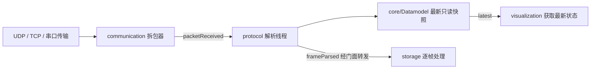

# 协议解析与共享数据对接

本文面向后续 storage、visualization 及其他业务模块开发。路径相对于仓库根目录，接口以当前源码为准。

## 1. 模块职责与依赖



| 模块 / 目标 | 职责 | 依赖 |
| --- | --- | --- |
| `communication` / `fosd_communication` | I/O、传输状态、字节流拆帧、数据报验证 | Qt Core / Network / SerialPort |
| `core` / `fosd_core` | 公共数据类型、只读快照、线程安全共享仓库 | Qt Core |
| `protocol` / `fosd_protocol` | 协议分派、字段校验与解析、发布快照 | `fosd_core`、`fosd_communication`、Qt Core |
| storage（待实现） | 从逐帧通知获取数据并持久化 | 数据类型需要 `fosd_core`；直接连接解析信号还需要 `fosd_protocol` |
| visualization（待实现） | 读取共享仓库并绘制数据 | 只使用仓库接口时需要 `fosd_core` |

core 不包含通信对象、socket 类型或协议解析算法。仓库仅前向声明 protocol 的写入者，不形成反向链接依赖。

源码入口：

- [ProtocolControl.h](../src/protocol/ProtocolControl.h)：解析门面、通知信号、共享仓库入口。
- [IFrameParser.h](../src/protocol/IFrameParser.h)：协议扩展接口。
- [WavelengthFrameParser.cpp](../src/protocol/WavelengthFrameParser.cpp)：当前波长解析实现。
- [FrameData.h](../src/core/Datamodel/FrameData.h)：数据结构与只读指针类型。
- [FrameRepository.h](../src/core/Datamodel/FrameRepository.h)：仓库读取接口。

## 2. 当前波长协议

依据 [QT解析代码.txt](QT解析代码.txt)，解析器标识为 `mp.wavelength`。完整帧长为 `10 + recordCount × 6`，多字节整数和浮点位模式均按小端读取。

| 帧头偏移 | 长度 / 字节 | 字段 | 说明 |
| --- | --- | --- | --- |
| 0 | 2 | magic | 数值 `0xA55A`，线上字节 `5A A5` |
| 2 | 1 | version | 保存原值 |
| 3 | 1 | dataType | 保存原值 |
| 4 | 2 | recordCount | `quint16`，记录数量 |
| 6 | 4 | sequence | `quint32`，设备帧序号 |

每条记录从 `10 + index × 6` 开始：

| 记录内偏移 | 长度 / 字节 | 字段 | 类型 |
| --- | --- | --- | --- |
| 0 | 1 | channel | `quint8`，传感通道 |
| 1 | 1 | sensor | `quint8`，传感器编号 |
| 2 | 4 | wavelength | IEEE 754 binary32，解码为 `float` |

解析器校验最小帧头、magic 和精确帧长；允许零记录。协议参考文本未规定版本、数据类型、通道或传感器的合法取值范围，也未定义 CRC，因此当前实现不附加这些限制。NaN、Infinity 保留为浮点值，下游按业务需要决定如何显示或存储。

两种“通道”不要混淆：`WavelengthRecord::channel` 是传感通道；`communication::Channel` / `core::TransportKind` 是 UDP、TCP、串口等传输方式。

| 协议标志 | communication 拆帧 | protocol 字段解析 |
| --- | --- | --- |
| `5A A5` | 默认启用 | 默认启用 `WavelengthFrameParser` |
| `FA FB FA FB` | 默认启用 JCS 数据规则 | 尚未实现，收到完整帧会报未识别协议 |
| `FA ch FA ch`，ch=1～16 | 已实现规则，默认工厂未启用 | 尚未实现 |
| 串口 `\r` 结束的指令 | 默认启用，保留结束符 | 尚未实现指令解析器 |

只有拆帧规则不代表已具备字段解析能力。JCS 后续需要独立的协议字段定义与解析器。

## 3. 创建、连接与线程

应用组合层负责创建门面。下面示例采用栈对象，反向析构会先停止 protocol，再停止 communication：

```cpp
#include "communication/ConnectControl.h"
#include "protocol/ProtocolControl.h"

fosd::communication::ConnectControl communication;
fosd::protocol::ProtocolControl protocol(&communication);
const fosd::core::FrameRepositoryPtr repository = protocol.dataModel();
```

构造 `ProtocolControl` 时会自动连接 `ConnectControl::packetReceived`，不要再重复连接，否则同一帧会解析两次。构造门面仅启动工作线程、建立连接，不会自动打开 UDP/TCP/串口；仍需由应用调用 `openUdp()`、`openTcp()` 或 `openSerial()`。

| 步骤 | 执行线程 |
| --- | --- |
| socket / 串口读取、拆帧 | communication 工作线程 |
| `ConnectControl` 转发 `packetReceived` | `ConnectControl` 所在线程，通常为 UI 线程 |
| 解析器工厂、`matches()`、`parse()`、仓库发布 | protocol 工作线程 |
| `ProtocolControl` 转发 `frameParsed` / `errorOccurred` | `ProtocolControl` 所在线程，通常为 UI 线程 |
| 下游处理槽 | 接收对象所在线程；跨线程连接应使用 `Qt::QueuedConnection` |

两个门面应在创建它们的线程析构，不要从它们各自的工作线程析构。门面转发和下游队列接收需要事件循环。新增解析器不得直接操作 UI。

传入空 communication 指针可用于测试或回放：

```cpp
fosd::protocol::ProtocolControl protocol;
protocol.parseFrame(fosd::communication::Channel::Udp, completeFrame, peer);
```

`parseFrame()` 异步排队，参数必须是完整帧。它不负责 TCP 半包缓存；实际通信应使用上面的自动连接。

## 4. 只读共享接口

| 类型 / 接口 | 返回内容 |
| --- | --- |
| `FrameDataPtr` | `std::shared_ptr<const FrameData>`，协议解析后的多态数据 |
| `FrameSnapshotPtr` | `std::shared_ptr<const FrameSnapshot>`，数据与来源信息 |
| `FrameRepositoryPtr` | `std::shared_ptr<const FrameRepository>`，只读仓库句柄 |
| `ProtocolControl::dataModel()` | 共享仓库句柄 |
| `FrameRepository::latest() const` | 最新成功解析帧；尚无数据时返回空指针 |

`FrameSnapshot` 字段含义：

| 字段 | 含义 |
| --- | --- |
| `protocolId` | 协议标识，当前波长协议为 `mp.wavelength` |
| `source.transport` | 传输方式 |
| `source.address` / `source.port` | 对端地址 / 端口；串口当前为默认空地址、0 端口，不包含串口名称 |
| `receivedAtUtc` | 当前实现于解析成功、准备发布时生成的 UTC 时间；不是设备采样时间或底层 socket 接收时刻 |
| `revision` | 仓库成功发布计数，从 1 递增；不同于设备的 `sequence` |
| `data` | 只读协议数据 |

仓库内部用 `QReadWriteLock` 保护最新快照及修订号。读取者只在复制快照指针时持有读锁，之后可独立处理快照，无须继续持锁。发布释放写锁后才发送帧通知。

`publish()` 是私有接口，仅 `ProtocolWorker` 能写入。默认解析器通过 `make_shared<const WavelengthFrame>()` 创建数据，仓库通过 `make_shared<const FrameSnapshot>()` 创建快照；下游不得移除 const 或持有可写别名。需要滤波、统计或格式转换时，创建下游自己的结果数据。

旧快照在新帧发布后仍有效。共享仓库句柄和已获取的快照可存活到门面析构之后，此时仓库不会再自动更新。

当前仓库只保存一个全局最新帧，不按协议或对端分别缓存，不保存历史。不同来源的数据会依次替换最新快照。

## 5. storage 与 visualization 接入

### storage：接收每一帧

连接 `ProtocolControl::frameParsed`，槽函数参数使用 `FrameSnapshotPtr`。下面的 `StorageWorker` 是未来模块需实现的类型，不是当前仓库已有类：

```cpp
// StorageWorker 需要实现：
// void enqueueFrame(const fosd::core::FrameSnapshotPtr &snapshot);

QObject::connect(&protocol,
                 &fosd::protocol::ProtocolControl::frameParsed,
                 storageWorker,
                 &StorageWorker::enqueueFrame,
                 Qt::QueuedConnection);
```

`storageWorker` 应在拥有事件循环的存储线程中执行写入。异步暂存快照时复制 shared_ptr，不要保存槽函数参数引用。通知携带的是该次发布的快照，不能在槽中改用 `latest()` 代替，否则可能错过中间帧。

当前信号链路不是持久化消息队列，没有容量控制、落盘确认或自动重试。未来 storage 应明确排队容量、过载策略和关闭时的排空机制。当前 protocol 析构会退出工作线程，不保证尚在队列中的帧全部处理；需要无损关闭时，应在应用层停止接收并确认处理、存储完成后再析构。

### visualization：按刷新频率读取最新帧

将 `FrameRepositoryPtr` 注入显示模块，在 UI 刷新时调用 `latest()`：

```cpp
#include "core/Datamodel/FrameRepository.h"

// repository 为应用注入的 FrameRepositoryPtr。
const auto snapshot = repository->latest();
if (!snapshot)
    return;

const auto wavelengths =
    std::dynamic_pointer_cast<const fosd::core::WavelengthFrame>(snapshot->data);
if (!wavelengths)
    return; // 当前最新帧可能属于其他协议。

for (const auto &record : wavelengths->records) {
    // 读取 record.channel / record.sensor / record.wavelength。
    // 实际控件更新放在 UI 线程。
}
```

可保存上次绘制的 `revision`，跳过重复刷新。读取最新状态允许跳过中间帧；需要绘制完整历史曲线时应接收逐帧通知，并在 visualization 自己的缓存中组织历史数据。

只使用仓库类型的模块可链接 `fosd_core`；若公共接口只包含 core 类型，可将依赖声明为 `PUBLIC`，按是否暴露头文件决定。直接引用 `ProtocolControl` 的模块还需链接 `fosd_protocol`。不要链接尚未创建的 `fosd_storage` 或 `fosd_visualization` 目标。

## 6. 新增协议

1. 在 `core/Datamodel` 新增派生于 `FrameData` 的数据结构。
2. 在 protocol 实现 `IFrameParser` 的 `protocolId()`、`matches()` 和 `parse()`。
3. `matches()` 精确识别协议类别；`parse()` 校验完整帧，失败返回空指针并填写错误，成功返回实际构造为 const 的数据对象。
4. 用 `ParserFactory` 注册新解析器，并把源文件加入对应 CMake 目标。
5. 新包头或不同帧长格式还需在 communication 配置对应 `PacketRule` / `DecoderFactory`。
6. 添加字段、异常数据、拆帧后解析及并发共享测试。

工厂示例：`MyFrameParser` 需由新协议实现，`createFrameParsers()` 返回当前默认解析器列表。

```cpp
fosd::protocol::FrameParsers createApplicationParsers() {
    auto parsers = fosd::protocol::createFrameParsers();
    parsers.emplace_back(new MyFrameParser);
    return parsers;
}

fosd::protocol::ProtocolControl protocol(
    &communication, nullptr, createApplicationParsers);
```

注入工厂替换默认工厂；希望保留默认协议时如上调用 `createFrameParsers()`。解析器按列表顺序匹配，首个匹配者负责解析；该解析器报错后不会尝试后续解析器。若新增解析器与默认波长解析器共享 `5A A5` 包头，需要按 version/dataType 等字段精确分派或调整注册顺序。

工厂和解析器均在 protocol 工作线程执行。解析实现应返回错误，避免让异常逃出 Qt 槽调用；不要创建或保留可被其他线程修改的已发布数据。

JCS 通道包头用一条 `FA ch FA ch` 规则覆盖 1～16 通道。当前 TCP 拆包器同位置匹配按规则顺序选择；同时启用 JCS 数据与通道规则时，固定 `FA FB FA FB` 规则要排在通用 `FA` 候选规则之前。新字段协议不能直接沿用现有的 10 字节头、6 字节记录长度而不核对设备协议。

## 7. 错误通知与测试

| 错误层 | 对外信号 | 错误类型 / 关键字段 |
| --- | --- | --- |
| 传输层 | `ConnectControl::errorOccurred` | `CommunicationError`：channel、operation、message、nativeCode |
| 拆帧层 | `ConnectControl::decoderErrorOccurred` | `DecoderError`：channel、operation、message、code |
| 协议层 | `ProtocolControl::errorOccurred` | `ProtocolError`：channel、peer、protocolId、message |

拆包器配置错误在信号连接后的 `initialize()` 中报告一次；正常半包缓存不会报错。被拆包器拒绝的数据不会进入 protocol。protocol 无匹配解析器时 `protocolId` 为空；已识别但解析失败时填写匹配的协议 ID。解析失败不发布快照、不增加 revision，也不覆盖已有数据。

门面只发送错误信号，应用负责连接日志或提示槽。

从仓库根目录运行现有预设：

```powershell
cmake --preset windows-msvc2017
cmake --build --preset windows-debug
ctest --preset windows-debug
```

已有 build 目录时，也可直接指定目标与配置：

```powershell
cmake --build build --config Debug --target test_protocol
ctest --test-dir build -C Debug -R '^test_protocol$' --output-on-failure
```

运行环境需要可找到当前配置对应的 Qt DLL。若 QtTest 输出未出现在终端，可显式写入文本日志：

```powershell
& './build/bin/Debug/test_protocol.exe' -o build/protocol_result.txt,txt
Get-Content build/protocol_result.txt
```

| 测试文件 | 主要覆盖 |
| --- | --- |
| [communication_tests.cpp](../test/communication_tests.cpp) | 真实 UDP/TCP、连接状态、拆包与错误转发 |
| [packet_decoder_tests.cpp](../test/packet_decoder_tests.cpp) | 半包、粘包、规则、JCS 16 通道、异常与恢复 |
| [protocol_tests.cpp](../test/protocol_tests.cpp) | 波长字段、小端浮点、零记录及最大记录数、异常帧、扩展解析器、线程归属、真实 UDP/TCP 全链路、并发读取与快照生命周期 |

整体构建组织见 [build-structure.md](build-structure.md)。
